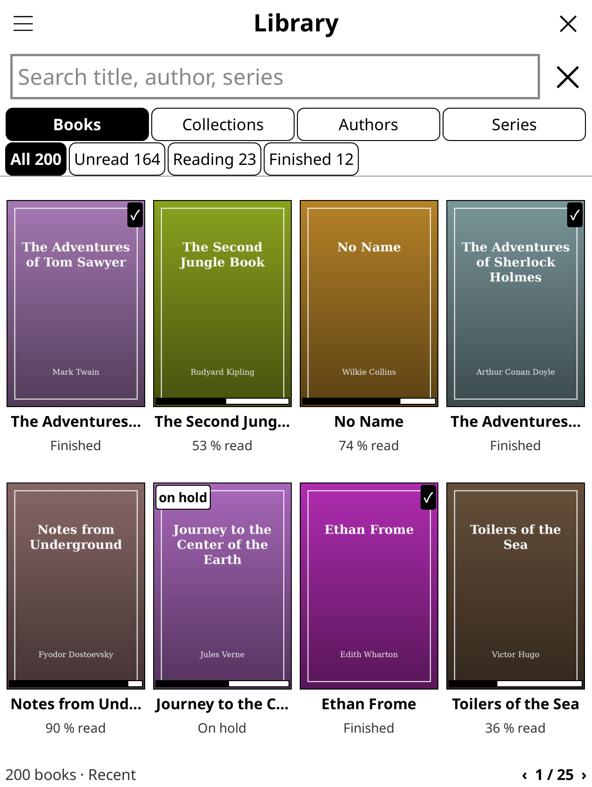
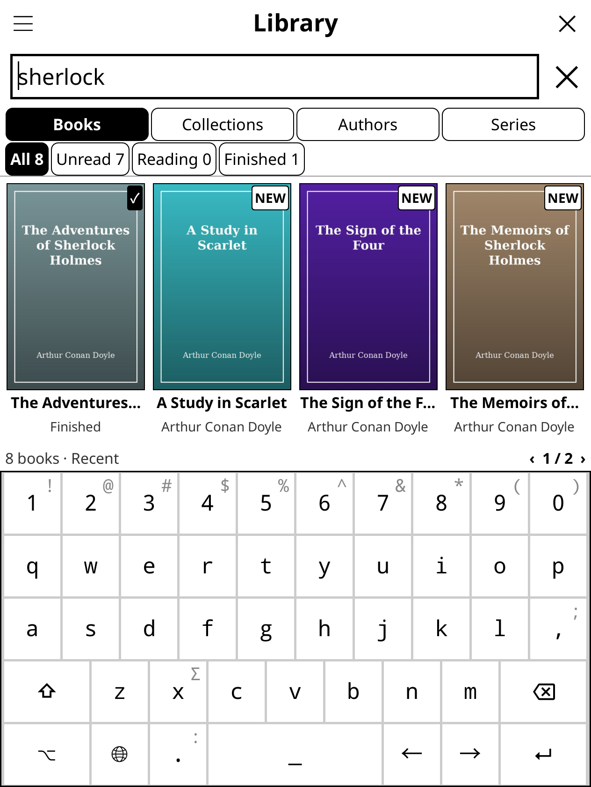
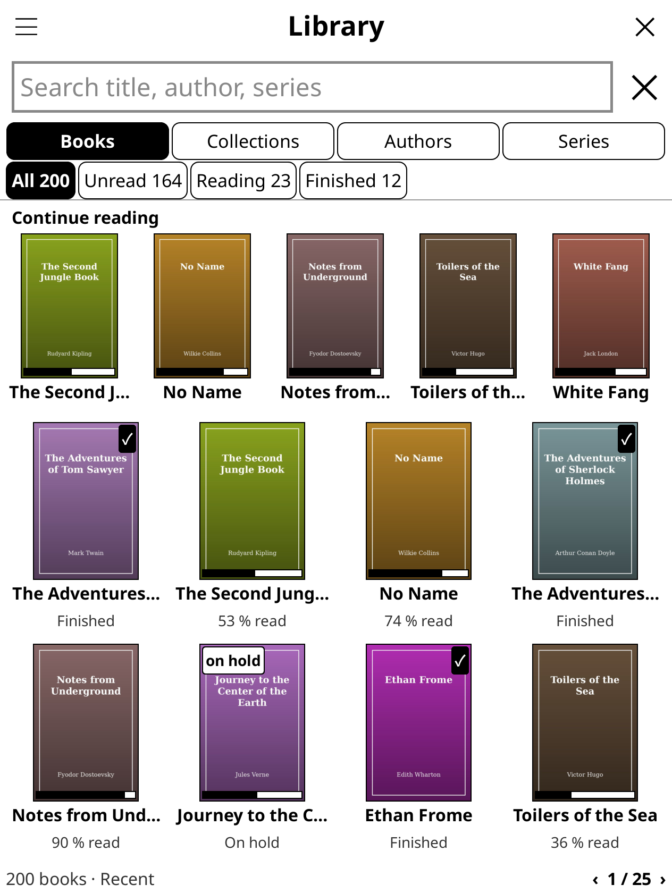
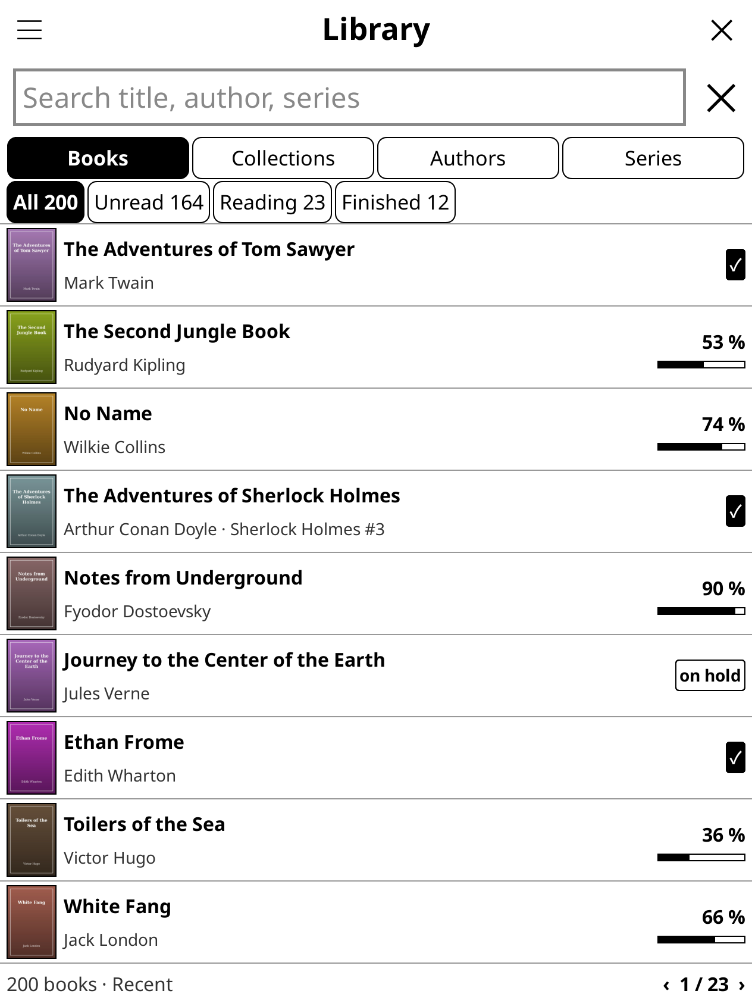
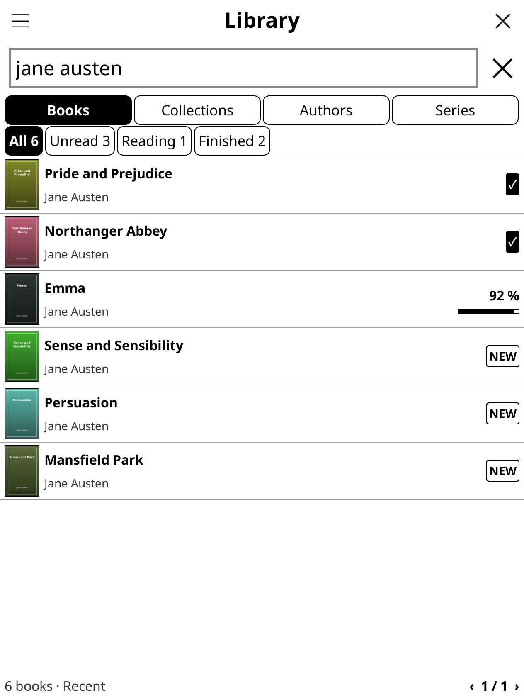
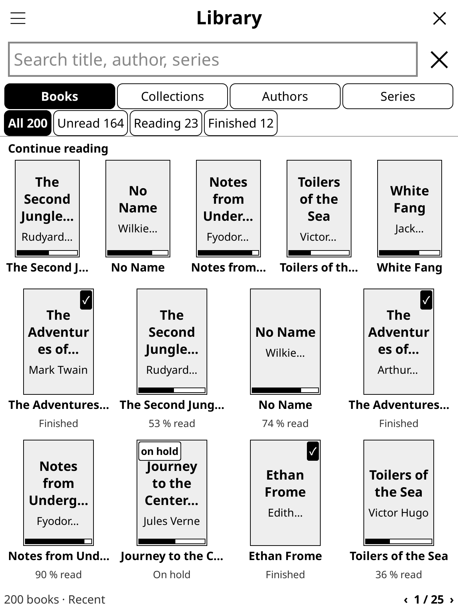

# koreader-library-search-toolbar

**Library** (`library.koplugin`) is a KOReader plugin that gives you a Kindle-style library: a cover grid (or a compact list) sorted by the book you opened last, a **Continue reading** row with the books you're in the middle of, a search bar that stays at the top of the screen and filters as you type, and one-tap filters for All / Unread / Reading / Finished. Collections, Authors and Series are top-level tabs.

It works alongside KOReader's file browser, History and Collections. It shows covers on its own. If **Project: Title** or the built-in Cover browser is enabled, it reuses their cover cache, so covers you already have show up straight away. It never moves or renames your books.

> **Early release (v0.2.0).** It has been tested in the KOReader desktop emulator (v2026.07.1), but not yet on many real devices. Please [open an issue](https://github.com/voantony/koreader-library-search-toolbar/issues) if something looks wrong on yours.

## Screenshots

| Library, sorted by recent | Searching as you type |
|---|---|
|  |  |

| Continue reading row | List view | List view, searching |
|---|---|---|
|  |  |  |

| Built-in covers: placeholders first | Covers a moment later |
|---|---|
|  |  |

More are in [screenshots/](screenshots/). They were taken in the emulator with dummy public-domain books.

## Install

1. Download **`library.koplugin.zip`** from the [latest release](https://github.com/voantony/koreader-library-search-toolbar/releases/latest).
2. Unzip it into KOReader's `plugins/` folder, so you end up with `…/koreader/plugins/library.koplugin/main.lua`:

   | Device | Plugins folder |
   |---|---|
   | Kindle | `/mnt/us/koreader/plugins/` |
   | Kobo | `/mnt/onboard/.adds/koreader/plugins/` |
   | PocketBook | `/mnt/ext1/applications/koreader/plugins/` |
   | Android | `koreader/plugins/` on internal storage |
   | Linux desktop | `~/.config/koreader/plugins/` |

3. Restart KOReader.
4. Open ☰ → **Library** → **Open Library**. If **Library** isn't in the menu, enable it under ☰ → Tools → More tools → Plugin management.
5. Optional: tick ☰ → Library → **Open Library at startup**.

Updating works the same way: replace the `library.koplugin` folder with the new one. Kindles that only connect over MTP, such as the Colorsoft: see [INSTALL_PLAN.md](INSTALL_PLAN.md).

## Features

- **Search bar, always on screen.** It is part of the Library screen, not a pop-up. Tap it and type: results update as you type, matching title, author, series and file name. Every word must match, case is ignored, and a search for `jane aus` finds *Jane Austen*. Searching runs on an in-memory index, waits 150 ms after the last key and redraws only the grid area below the bar. Tap **Enter** or anywhere outside the keyboard to hide the keyboard and keep the results. Tap **✕** to clear.
- **Cover grid** with a reading-progress bar and the percentage read, a **✓** on finished books, **NEW** on books you haven't opened and **on hold** on abandoned ones. Books with no cover yet get a plain placeholder with the title until the cover is extracted.
- **List view.** ☰ → **View: List** shows one book per row: a small cover, the title, the author (and series), and on the right the percentage read with a bar, or **✓**, **NEW** or **on hold**. About 9 rows fit on a page on a Kindle Colorsoft (up to 10 on bigger screens). Tap a row to open the book; long-press it for the same menu as on a cover. Collections, Authors and Series show one group per row with its book count. ☰ → **View: Grid** switches back.
- **Continue reading.** At the top of the Books tab, a row of up to five larger covers shows the books you're reading, most recently opened first, each with its progress bar and a caption such as *43 % · 3 h ago* (older than a month: the date). Tap one to pick up where you left off: the book opens on the page you were on, not page 1. The **▶ Resume *title* 43 %** button next to the heading opens the most recent one in one tap. The row hides while you search, when a filter other than *All* is selected, while the keyboard is up, and when nothing is in progress. Turn it off with ☰ → **Show Continue reading**.
- **Recently opened.** ☰ → Library → **Top row** switches the row at the top of the Books tab between *Continue reading* (the default) and *Recently opened*, which shows the last five books you opened, newest first, whatever their status: finished books (with **✓**), books on hold, and books you opened but haven't started. Books you have never opened, and books whose file is gone, are left out. The order comes from KOReader's History. The **▶ Resume** button stays on the most recent book you are still reading (it is hidden if there is none), so one tap still takes you back into your current book even when the newest cover is one you finished.
- **Sort**: Recent (last opened; the default), Title, Author, Series, Date added.
- **Tabs**: Books · Collections · Authors · Series. Opening a group shows its books, with a **← group** chip to go back.
- **Series.** Opening a series lists its books in series order, each titled with its number (*3 · Ozma of Oz*); books without a number come last, by title. The footer shows how far you are (*2 of 7 read · series 5 of 10*). Swiping past the last page of a series opens the next series, and swiping back past the first page opens the previous one, so you can page through all your series without going back to the list.
- **Next in series, from inside a book.** ☰ → Library shows **Next in series: 4 · Dorothy and the Wizard in Oz** and **Previous in series: 2 · …** while you read a book that is part of a series. *Next* skips books you have already finished (turn that off in ☰ → Library); if every later book is finished it opens the very next one. Books open where you left off.
- **Library tab in the reader menu.** While reading, the top menu bar has a Library tab (the open-book icon, next to the file browser's folder). Tap the top of the screen, then the icon, and the Library opens over the book. Turn it off with ☰ → Library → **Library tab in the reader menu**.
- **Sleep screen: cover of last book.** ☰ → Library → **Sleep screen: cover of last book** makes the sleep screen show the cover of the book you read last, both while reading and from the Library or file browser. It switches on KOReader's own *Show book cover on sleep screen* (Settings → Screen → Sleep screen) and, if *hide the cover in the file browser* was on, turns that off. If the book has no cover, or KOReader can't read one, you get your usual sleep screen image (or the KOReader logo). Turning the option off puts back the sleep screen you had before. Off by default.
- **Filters**: All / Unread / Reading / Barely started / Finished, each with a count. On-hold books appear only under *All*. **Barely started** shows books you have opened but read less than 10 % of (5, 10, 20 or 25 %; set it in ☰ → Library or the Library's ☰ menu). Books you have never opened, and books at 0 %, are not included. On narrow screens the chips drop the counts of the unselected filters to fit.
- **Long-press a book** to set its status, show its folder, view book information or open it.
- **Swipe** left and right, or use the page keys, to turn pages. The **‹ 1 / 25 ›** buttons do the same.
- **Startup**: optionally show the Library instead of the file browser when KOReader starts, and go back to it after closing a book. Closing the Library (✕) always takes you to the normal file browser, so it is a safe fallback.
- **Gestures**: these actions can be assigned under *Taps and gestures*:

  | Action | Where | What it does |
  |---|---|---|
  | Library (`library_show`) | everywhere | Open the Library |
  | Search library (`library_search`) | everywhere | Open the Library with the keyboard up |
  | Resume last book (`library_resume`) | everywhere | Open the most recently read unfinished book where you left off |
  | Rescan library (`library_rescan`) | everywhere | Re-read the library folder |
  | Next in series (`library_next_in_series`) | while reading | Open the next unread book of this book's series (or the very next one, see above) |
  | Previous in series (`library_prev_in_series`) | while reading | Open the book before this one in its series |

### Where the metadata comes from

For each book the plugin uses the first source that has data:

1. **`metadata.calibre`** (written by calibre or KOReader's Calibre plugin), if one exists in the library folder, one of its parent folders or the inbox folder.
2. **The cover cache** (`BookInfoManager`) of Project: Title or Cover browser, if one of them is enabled.
3. **The book's sidecar** (`.sdr`) once you have opened the book.
4. **The file name.**

Reading status and progress always come from the sidecar. *Last opened* comes from KOReader's History. The index is saved to `settings/library_index.lua`, keyed by each file's path, size and modification time, so later scans only re-read what changed.

### Where the covers come from

For each tile the plugin uses the first of these that has a cover:

1. Its own thumbnail of the book, in `cache/library_covers/`.
2. The Project: Title / Cover browser cache, if one of them is enabled.

If neither has one, the tile shows a placeholder with the title, and the cover is extracted in the background:

- **With Project: Title or Cover browser enabled**, the plugin asks their cache to extract it, as before. Their cache is shared with the file browser, so each cover is stored once.
- **Without them**, the plugin does it itself. A background process opens the book with KOReader's own `getCoverImage`, so a custom cover set under *Book information* wins over the one in the book. It shrinks the cover to the largest tile the grid uses (3 columns) and saves it as a small JPEG in `cache/library_covers/`. Books on the current page go first, then the Continue reading row, then the rest. The process stops when you close the Library. If a book has no cover, or can't be opened, the plugin writes a small marker file and doesn't try that book again until the file changes.

Each tile redraws when its cover arrives. Covers you see are scaled from these files, so turning pages doesn't open any books. Changing the number of columns doesn't re-extract anything. Setting or removing a custom cover replaces the thumbnail. ☰ → Library → **Clear cover cache** deletes the thumbnails, and they are extracted again the next time you open the Library.

## Requirements

- KOReader **v2025.04 or newer**. Tested on **v2026.07.1**, in the desktop emulator.
- Nothing else. Covers no longer need Project: Title or Cover browser. If one of them is enabled, the Library uses its cover cache too.

## Install from source

Copy the `library.koplugin` folder from this repository into KOReader's `plugins/` folder, using the table above. Only the seven `.lua` files inside it are needed.

## Settings

You can change these under ☰ → Library, or with the ☰ button in the Library's top-left corner:

| Setting | Default |
|---|---|
| Open Library at startup | off |
| Return to Library after closing a book | on |
| Sort | Recent |
| View | Grid (Grid / List) |
| Show Continue reading | on |
| Top row | Continue reading (Continue reading / Recently opened) |
| Columns | 4 (3–6) |
| Library folder | KOReader home folder |
| Include hidden folders | off |
| Barely started: below | 10 % (5 / 10 / 20 / 25 %) |
| Library tab in the reader menu | on |
| Sleep screen: cover of last book | off |
| Next in series skips finished books | on |

Settings are stored in `settings.reader.lua` under the key `library_plugin`.

## Uninstall

1. Turn off **Open Library at startup** if you turned it on. This step isn't strictly needed: without the plugin, the setting is ignored.
2. Delete `plugins/library.koplugin/`.
3. Delete `settings/library_index.lua` (the plugin's index) and the `cache/library_covers/` folder (its cover thumbnails). If KOReader was closed while covers were being extracted, a `cache/library_covers_cr3tmp/` folder may be left too; delete it as well.
4. Restart KOReader.
5. Optional: with KOReader closed, remove the `["library_plugin"] = { … },` block from `settings.reader.lua`. If you leave it, it does no harm.

The plugin writes to two places other than its own files. First, the status buttons write to the book's sidecar; these are the same buttons KOReader's History uses. Second, when Project: Title or Cover browser is enabled, it adds missing covers to their cache, which is the same thing those plugins do on their own.

## Performance

These were measured in the KOReader v2026.07.1 desktop emulator with 200 dummy EPUBs and a 1264×1680 screen at 300 dpi. See [bench/RESULTS.md](bench/RESULTS.md) for details and for how to rerun them.

| | median | max |
|---|---|---|
| Search: filtering the 200-book index per keystroke | 0.06 ms | 0.31 ms |
| Search: filtering a 2,000-book index per keystroke | 0.02 ms | 0.77 ms |
| Search: filter + rebuild + repaint per keystroke | 33 ms | 33 ms |
| First scan (no index cache, metadata.calibre) | 6 ms | 11 ms |
| First scan (no index cache, no metadata.calibre, cover DB) | 14 ms | 20 ms |
| Cached scan (index cache on disk) | 4 ms | 5 ms |
| Open the Library: build + paint | 31 + 18 ms | |
| Turn a page (covers not yet scaled) | 27 ms | 37 ms |
| Turn a page (covers cached) | 17 ms | 29 ms |

Built-in covers, with Project: Title and Cover browser disabled:

| | |
|---|---|
| Extract all 200 covers, empty cache | 5.7 s (first page shown after 0.6 s) |
| Turn a page while extracting | 21 ms median, 25 ms max |
| Thumbnail cache on disk | 3.7 MB for 200 books (396×594 JPEGs) |
| Open the Library, thumbnails on disk | 43 ms median, 55 ms max |
| Turn a page, thumbnails on disk | 33 ms median, 34 ms max |

A Kindle is much slower than a desktop and e-ink refreshes take their own time, so treat these as relative numbers.

## Development

```
library.koplugin/
  _meta.lua          plugin name and description
  main.lua           menus, settings, startup, dialogs, gestures
  libraryview.lua    the Library screen: title bar, search bar, tabs, chips, Continue reading, grid or list, footer
  librarytile.lua    cover tiles, list rows, badges, chips, tabs, progress bars, LRU cache of scaled covers
  librarycovers.lua  built-in covers: thumbnail files, extraction queue, background process
  librarykeyboard.lua  "Rounded keyboard in search": a restyled keyboard for the search bar only
  libraryindex.lua   scan + metadata (calibre > cover DB > sidecar) + on-disk cache
  librarycore.lua    pure logic: sorting, grouping, filters, search index, grid and list maths, Continue reading picks
spec/                tests (run.lua is a tiny runner for LuaJIT / Lua 5.1)
tools/
  make_dummy_library.py     generates N public-domain EPUBs with covers + metadata.calibre
  librarybench.koplugin/    emulator benchmark + screenshots (development only, never install)
screenshots/         emulator screenshots of the dummy library
bench/RESULTS.md     benchmark numbers
```

```sh
make test                   # or: luajit spec/run.lua  (KOReader's own luajit works)
make stage                  # dist/library.koplugin/ + dist/SHA256SUMS, the files to install
```

The tests use in-memory fixtures. The emulator library is generated from public-domain titles. `.gitignore` excludes books, `.sdr` folders, KOReader settings, history and cache files, so device data can't be committed by accident.

## Roadmap

- Read EPUB covers straight from the zip, without opening the book in the rendering engine. This would make first extraction faster for EPUBs. Not started.

## License

[MIT](LICENSE)
