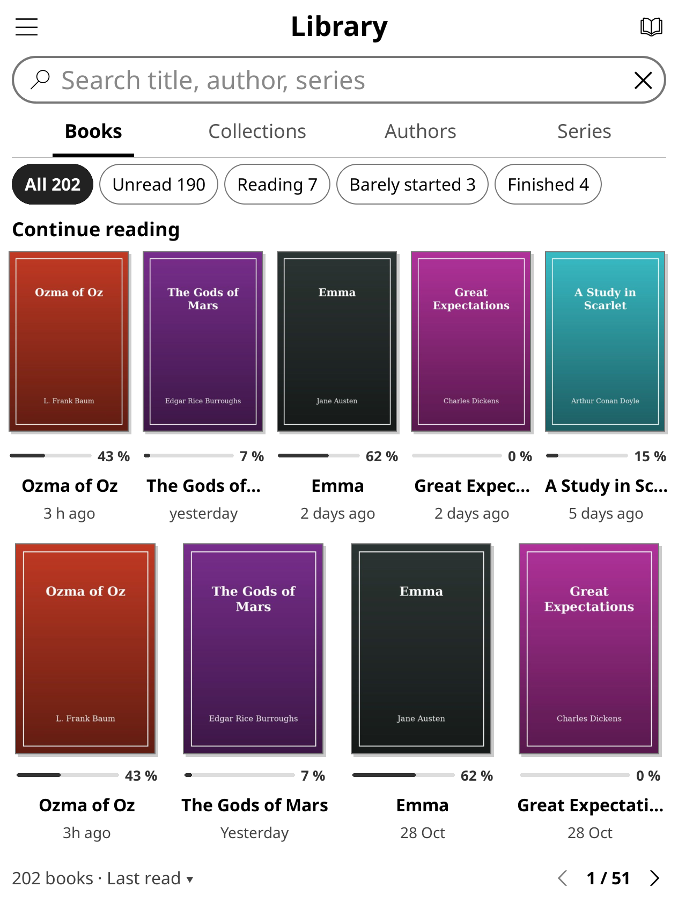
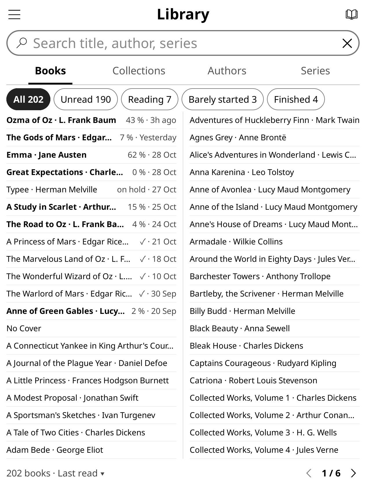
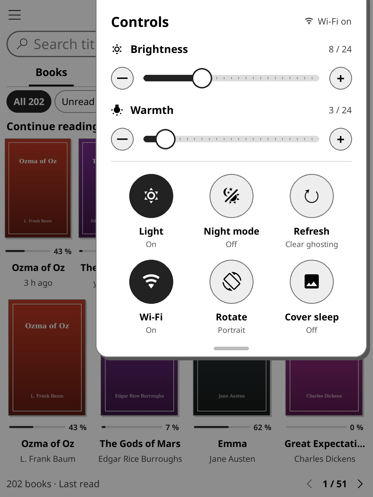
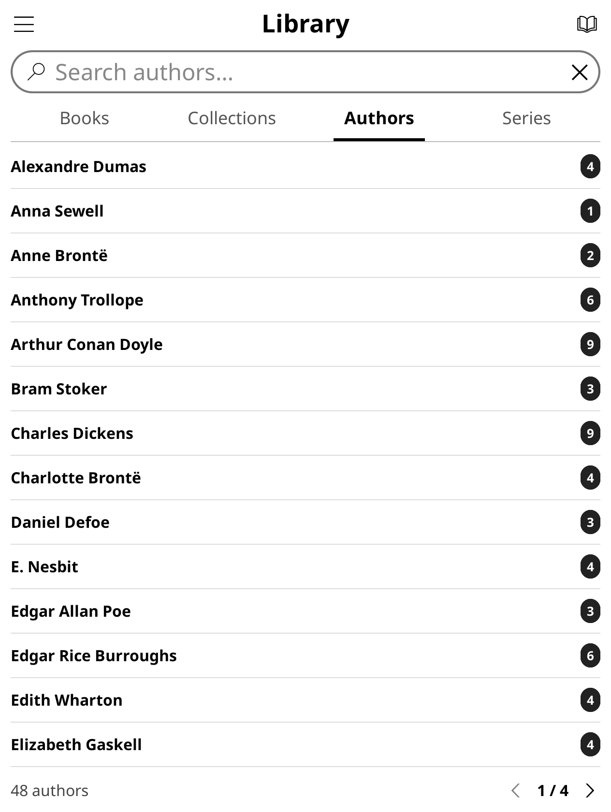
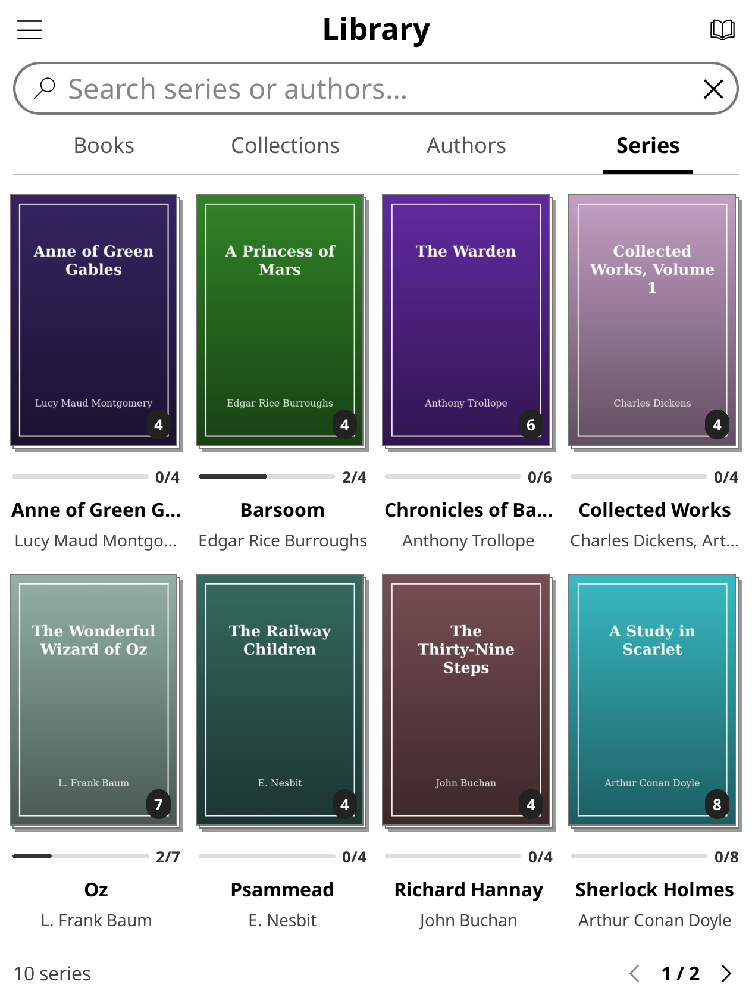
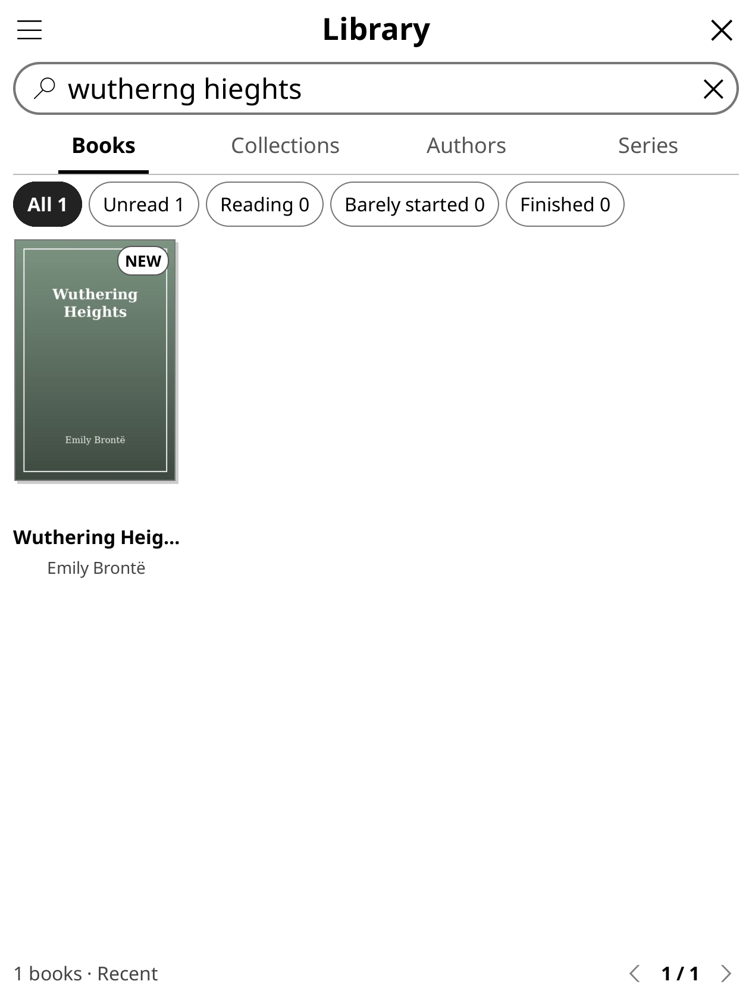
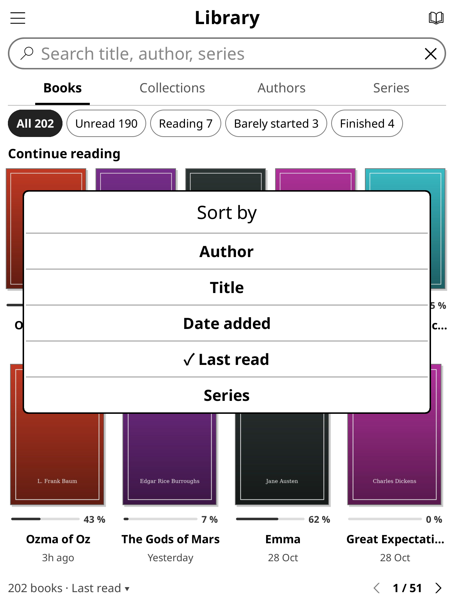
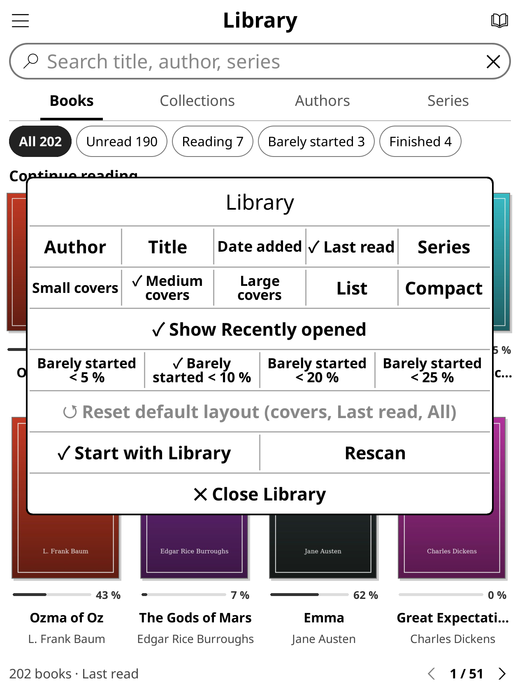
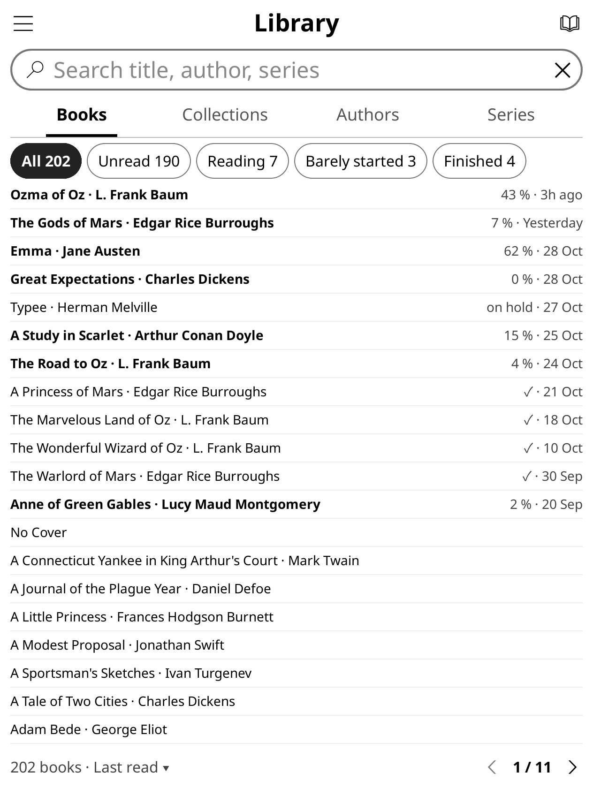

# Library GUI for KOReader

Library GUI (`library.koplugin`) is a KOReader plugin that replaces the file browser with a library screen that looks and works more like the Kindle's own home screen: book covers with reading progress, a search bar at the top, tabs for Books, Collections, Authors and Series, and a quick settings panel you pull down from the corner.

It sits alongside KOReader's file browser, History and Collections. It never moves or renames your books, and closing it takes you back to the normal file browser.

| Books, covers | Compact · 2 columns | Controls panel |
|---|---|---|
|  |  |  |

| Authors | Series | Search with typos |
|---|---|---|
|  |  |  |

| Sort from the footer | View picker in the ☰ menu | Compact with dates |
|---|---|---|
|  |  |  |

The screenshots were taken in the KOReader emulator at the Kindle Colorsoft's screen size (1264×1680), with a library of public-domain books.

## Features

- **Search** at the top of every tab. It filters as you type and searches whatever the tab shows: books on Books, author names on Authors, series on Series, collection names on Collections, and only that shelf's books inside an author, series or collection. Small typos, missing accents and punctuation are forgiven, so `charlote bronte` finds Charlotte Brontë.
- **Filters**: All, Unread, Reading, Barely started and Finished, each with a count.
- **Sort** by Author, Title, Date added, Last read or Series. Tap the label in the footer (*202 books · Last read ▾*) to change it.
- **Views**: Small, Medium or Large covers, List, Compact, and Compact · 2 columns. The view, sort and filter are remembered for each tab and each author, series or collection you open.
- **Dates**: sorted by Last read or Date added, each book shows its date (*3h ago*, *Yesterday*, *12 Oct*).
- **Continue reading**: a row of the books you are in the middle of, at the top of the Books tab. Tap one and it opens on the page you were on.
- **Resume icon** in the top-right corner opens the book you read last in one tap.
- **Recently opened**: switch the top row to show the last five books you opened instead, finished ones included.
- **Collections and Series** as tabs. A series lists its books in order, and swiping past its last page opens the next series.
- **Go to page**: tap the page number in the footer (*1 / 51*) and type a page.
- **Cover sleep screen**: one toggle to show the cover of the book you read last on the sleep screen. Turning it off puts back the sleep screen you had.
- **Controls panel**: swipe down from the top-right corner for Brightness and Warmth sliders and buttons for Light, Night, Refresh (clears e-ink ghosting), Wi-Fi, Rotate and Cover sleep. Anything your device doesn't have is left out.
- **Covers without other plugins.** Library GUI extracts covers itself in the background. If Project: Title or Cover browser is enabled, it reuses their cover cache.
- **Gestures**: Open Library, Search library, Resume last book, Rescan library, and Next / Previous in series can be assigned under *Taps and gestures*.

## Install

1. Download `library-gui-<version>.zip` from [Releases](https://github.com/voantony/koreader-library-gui/releases).
2. Unzip it. You get a folder called `library.koplugin`.
3. Copy the `library.koplugin` folder into `koreader/plugins/` on your device, so you end up with `koreader/plugins/library.koplugin/main.lua`.
   - On a Kindle that is `/mnt/us/koreader/plugins/` (it shows as `koreader/plugins` when the Kindle is plugged in).
   - On a Mac, newer Kindles such as the Colorsoft connect over MTP and don't show up in Finder. [OpenMTP](https://openmtp.ganeshrvel.com/) works for copying the folder across.
   - Kobo: `/mnt/onboard/.adds/koreader/plugins/`. PocketBook: `/mnt/ext1/applications/koreader/plugins/`. Android: `koreader/plugins/` on internal storage.
4. Restart KOReader (☰ → Exit → Restart KOReader).
5. Open ☰ → **Library** → **Open Library**. To open it every time KOReader starts, tick **Open Library at startup** in the same menu.

To update, replace the `library.koplugin` folder with the new one and restart KOReader.

If **Library** is missing from the menu, check ☰ → Tools → More tools → Plugin management, where it is listed as Library GUI.

### For developers and Mac users

[`tools/kpush/`](tools/kpush/) is an optional command-line tool for macOS that copies the plugin files to a Kindle over MTP in one go, without Calibre. It was written for the Kindle Colorsoft, whose USB connection tends to drop after each libmtp command. See its [README](tools/kpush/README.md) for how to build and use it. You don't need it to install the plugin.

## Compatibility

- Tested on a **Kindle Colorsoft** running KOReader v2026.07.1, and in the KOReader desktop emulator.
- Needs KOReader v2025.04 or newer.
- It should work on other devices that run KOReader (Kobo, PocketBook, Android), but I haven't tried them. If you do, please open an issue and say how it went.

## Uninstall

Delete `koreader/plugins/library.koplugin/` and restart KOReader. To remove everything it made, also delete `koreader/settings/library_index.lua` and the `koreader/cache/library_covers/` folder.

## About this project

This is the first thing I've developed in public. I built it with Grok Bot, and I'm happy to take any suggestions and feedback: [open an issue](https://github.com/voantony/koreader-library-gui/issues) for bugs, ideas or anything that looks off on your device.

Ideas came from [Project: Title](https://github.com/joshuacant/ProjectTitle), [SimpleUI](https://github.com/doctorhetfield-cmd/simpleui.koplugin) and ZenOS. Only ideas: no code was copied from them or from KOReader, and Library GUI is written from scratch under the MIT licence.

## Development

See [CONTRIBUTING.md](CONTRIBUTING.md) for running the tests and the emulator. Benchmarks are in [bench/RESULTS.md](bench/RESULTS.md).

## Licence

[MIT](LICENSE)
